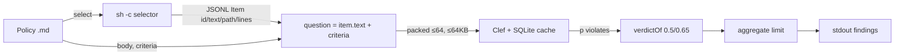

# Decomposing lint-anything: selecting, rules, judging

Design notes (2026-10-26). Steps 1 and 2 of the suggested order are done, including a published library entry; steps 3 and 4 are not implemented. Anything that changes CLI surface, output, side effects, or the policy file format needs explicit user approval (`AGENTS.md`).

## Where the seams are today

Most of the seams already exist:

- The JSONL item contract (`src/item.ts`) separates selecting from judging.
- `Clef` is an Effect service, and evals already stub it (`evals/shared.ts`).

One thing is still coupled: the `Policy` type (`src/policy.ts`) bundles selector, rule, cut-offs, and `limit`.

`src/clef.ts` no longer knows what a lint policy is (2026-10-26):

- `Clef.ask(source, state, questions)` takes `Question`s (`{instructions, criteria}`) and returns, in order, the probability of yes or `RequestTooLarge`.
- `source` only keys `stats` (the CLI passes the policy name).
- `planRequests(state, questions)` replaces `planItemRequests(policy, items)`.
- The rule-to-question mapping is `itemQuestion(policy, item)` in `src/lint.ts`, with state `policy.body`.
- Request bodies and cache keys are byte-identical to before: plans for all 21 corpus policies matched the old code, and existing caches still hit.

| Stage | Contract | Where it lives now |
| --- | --- | --- |
| Select | `() → Item[]` | `src/select.ts`, `src/item.ts` |
| Rule | `{body, criteria}` + `Item → Question` | `src/lint.ts` (`itemQuestion`) |
| Judge | `(source, state, Question[]) → p[]` | `Clef.ask`, `planRequests` (`src/clef.ts`) |
| Decide | `p → Verdict`, then `aggregate` | `src/lint.ts` (`verdictOf`, `aggregate`) |
| Report | `Finding[] →` text | `index.ts` |

Done: `Clef` takes questions instead of `Policy`. The judge, its cache, and its packer know nothing about linting.

## Seam 1: selectors apart from rules

Shape: a library of named selectors (functions, tests, error handlers, commits, PRs), each emitting items, with rules referencing them.

Some of this works today by convention:

- `select: sh .lint-anything/lib/functions.sh`.
- Identical commands already run once per lint run (`evals/shared.ts`: 6 runs → 1).

What's missing is metadata: what kind of unit a selector emits, and which rules use it.

Unlocks:

- **Cross-language rules.** One rule ("no flag parameters") with a TS, Go, and Python selector each.
- **Selectors as a product.** "Semantic units plus computed facts" is useful beyond linting: picking review targets, chunking for RAG or embeddings, finding test gaps. `evals/steps/` (`functions.ts`, `blame.ts`, `duplicates.ts`, `present.ts`) already is that library, hidden in evals.
- **Coverage view.** A rules × selectors matrix shows which units no rule covers, and which rules can't reach where their violations happen.

Measured risk: a selector belongs to its rule.

- Reworded rules sent through selectors built for the polished wording lost 0.03–0.05 AUROC.
- Those selectors also reached fewer gold ranges (87–95% vs 98%). See README, "Rule wording".

So share a selector only for the unit cut (the function, the test). Keep per-rule facts (`--flags`, call sites, age in days) with the rule. Those facts carry the accuracy: 76% → 99% in `evals/history.ts`.

## Seam 2: rules apart from the judge

Shape: a `Judge` interface, `(state, questions) → probabilities`. Clef is one backend; others could be a deterministic judge, another LLM, or a human.

Unlocks:

- **Mechanical rules: no separate judge (rejected 2026-10-26).** The selector already covers this. It drops items it knows pass, and writes computed facts into the text of the rest, so Clef's judgment of them is near-certain and cached after the first run. Control rules already score item AUROC 1.0 this way.
- **Explanations: rejected (2026-10-26).** A second LLM writing a reason for each non-passing finding would only move LLM cost into the tool. The consumer is a coding agent that is itself an LLM and reads the item to fix it anyway. Findings keep `criteria.true` as their reason.
- **Comparing judges.** The eval harness could score Clef against other models on the same 10,623 cases. That makes it easier to switch vendors.
- **Cascades.** A cheap judge first, with Clef only for uncertain items. Caveat: the `ask` routing pre-filter failed (commit `a4caa7c`: more false alarms, fewer violations caught). A cascade needs its own eval first.
- **A general batched yes/no classifier.** The packer, the content-addressed SQLite cache, retries, and sorted packing for stable answers make a generic way to ask N yes/no questions under shared context. Uses beyond lint: issue triage, routing PRs to reviewers, labeling commits or changelogs, data labeling.

## Seam 3: deciding apart from judging

`verdictOf` and `aggregate` are pure functions over probabilities. As a separate layer:

- `limit` can grow into ratios, trends across runs, and per-directory budgets. Counting in code beats asking Clef to count (100% vs 92%, `evals/counts.ts`).
- Probabilities stay comparable across judges, so calibration can be checked per backend.
- Per-policy cut-offs were measured and rejected (surfaced violations 72% → 52%, `evals/cutoffs.ts`). This layer should not become per-rule tuning.

## Components with standalone value

| Component | Standalone use |
| --- | --- |
| `evals/corpus` (623 files, 10,623 labeled cases, two-model labeling protocol) | Public benchmark for semantic code rules; scores any judge or rule wording |
| `evals/mine.ts` (violations mined from PR review comments) | **Finding rules from review history:** mine a repo's review comments for rules the team already enforces informally, then draft policies |
| `evals/steps/*` | The selector library (Seam 1) |
| `evals/sample.ts`, `evals/wordings.ts` | A tuning loop for any rule an agent writes, not just this corpus. Built 2026-10-27: see "Policy tuning loop" |
| Answer cache + packer (`src/clef.ts`) | The batched yes/no classifier (Seam 2) |

## Policy tuning loop (built 2026-10-27)

Option A of the design discussion: a skill script on a shared scoring module, with no CLI change.

- **Labels**: `.lint-anything/labels/<policy>.jsonl`, committed next to the rules; the CLI never reads them. Each line labels a file (`path`) or a pathless item (`item`) as `violates` (with violation line ranges), `complies`, or `ambiguous`, in split `dev` or `test`. Labels name code locations, so they survive selector changes: an item is a violation when its lines overlap a labeled range, and a file scores its highest item.
- **Who labels**: two or three different models independently; files where they disagree, or any calls ambiguous, go to the user; the user's call is recorded, and "reviewers could disagree" stays `ambiguous` (owner decision).
- **Code**: `src/score.ts` holds label parsing, item labeling, file scores, reach, every metric, and the bootstrap intervals. It is exported from the library (`scorePolicy`, `loadLabels`, metrics).
- **Script**: `score.ts` is bundled to `skills/lint-anything/scripts/score.js`, which is gitignored and shipped. `bun score.js <policy> [candidate.md]` judges only items in labeled files, sharing the CLI's cache. Per split it prints reach, AUROC with a 95% interval, caught, surfaced, false alarms, and ambiguous → review. A candidate gets paired deltas. Dev mistakes and unreached violations are listed; test is only summarized. The rule: adopt on test, outside noise.
- **Dogfooding**: the evals label, aggregate, and score the corpus with `src/score.ts`. Their judging path (cached client, request shapes, unsorted item order) stays their own, because sorting would reorder 21% of item groups and invalidate the eval cache.

## Constraints

Fine without approval:

- Internal refactors (decoupling `Clef` from `Policy`).
- Programmatic exports of the select, judge, and decide stages.
- Moving `evals/steps` into a selectors package.

Needs explicit approval first:

- New CLI flags, subcommands, output, side effects, or env vars.
- Policy format changes (a `selector:` reference, a `judge:` key).
- Changing what `reason` prints.

## Suggested order

1. Done: internal refactor. `Clef` takes questions, not `Policy`. No user-visible change; verified with `bunx tsc --noEmit` and a CLI run.
2. Done in the repo: `src/lint.ts` exports the stages, and `lint` is their composition per policy.
   - `select(policy, cwd?, runs?)`: runs the selector, sorts items, checks paths for `limit: per file`.
   - `judge(policy, items)`: the `Clef` service's probabilities.
   - `decide(policy, items, answers, threshold)`: pure; findings and `limit` aggregation.
   - `evals/counts.ts` uses `decide` instead of rebuilding findings; its output is unchanged.
   - Library (2026-10-26, after briefly deciding against it): the package exports the stages as an Effect API, with `effect` as an optional peer dependency (`src/lib.ts`, `exports` in `package.json`, `dist/lib.js` + `dist/types`). The CLI bundle is unchanged and still self-contained. The SIGHUP handler moved from `src/select.ts` into `index.ts`, so importing the library installs no signal handlers. README, "Library".
3. Rejected (2026-10-26): explanations (see Seam 2), and deterministic judging, which belongs in the selector (see Seam 2). No policy-format or item-contract change.
4. Separately: finding rules from review history, as its own tool. It builds on `evals/mine.ts` and doesn't touch the lint CLI.
   - Tested before building (2026-10-26, `evals/discover.ts`, `evals/RESEARCH.md` H23). Twelve repos, their latest ~400 human review comments each, against 1,001 code norms from their own docs.
   - Of the documented norms reviewers invoked in that window, 38% came back as a theme (20% in each repo's top 20).
   - 59% of themes share no norm. About 2.5 real undocumented norms per repo were raised by two or more reviewers.
   - Clef's keep step is not where norms are lost (78% of the relevant comments kept); clustering raw comment prose is.
   - Not worth building as tested. Next test if pursued: abstract each kept comment into a one-line rule before clustering.

## Stages as processes (not pursued)

Recorded when the plan was "a tool, not a library"; superseded by the library, kept as an option.

The unit of composition is a process speaking JSONL, not a TypeScript function. Selectors already work this way: any shell pipeline that prints items. The same shape could apply to the other stages, without flags, because every line carries what that stage needs:

| Stage as a process | stdin (JSONL) | stdout (JSONL) |
| --- | --- | --- |
| select | (none; the user's pipeline) | `{id, text, path?, lines?}` |
| ask (judge) | `{id, state, instructions, criteria}` | `{id, p}` or `{id, error}`; batched, packed, cached as today |
| decide | `{id, p, path?, lines?, criteria}` + cut-offs/limit | findings |

An `ask` process makes Clef's batched, cached yes/no judgment usable from any pipeline: triage, commit checks, data labeling. `lint-anything` stays the one fixed command that composes all three from policy files.

Shipping selectors as shell scripts in the package (as `skills/` ships today) fits this too, with no new command surface.

New commands or bins are CLI surface: none ships without explicit approval of its name and line formats.
